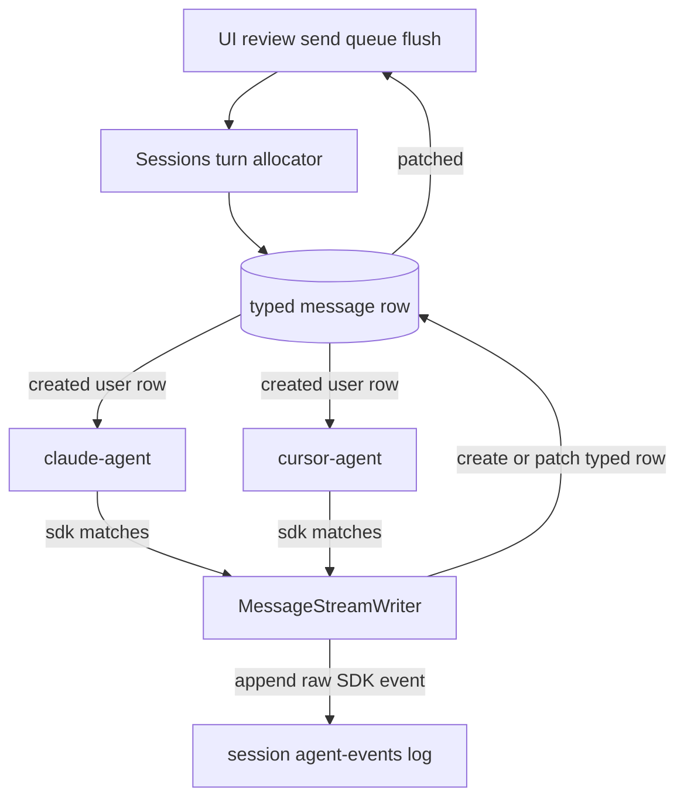

# Single typed row per chat message

One database row per bubble in chat. Tool progress and extra text update that row (`patched`). `message_json` is a closed TypeScript union: every field is something the UI reads, and every finished tool call has an explicit `result` type. The agent SDK’s original event is appended under the session directory, not stored on the row.

## Target flow



1. A user message create assigns `turn_id` (new turn, or the active turn when steering).
2. Both SDK services listen to `messages` and `session-review-messages` `created`. Each ignores the event unless its SDK owns that channel.
3. The matching service starts a turn or steers. A different `turn_id` while a turn is running is rejected with a system status row.
4. That service writes every follow-up row, including a typed `result` when a tool finishes, and appends the raw SDK event to disk.

---

## Typed payloads

[`shared/session-messages.ts`](../shared/session-messages.ts) is the only shape written to `message_json`. Validate before insert/patch. The row `type` matches the discriminant.

### Tool call envelope

Every `tool_call` row:

- `id` — also the `tool_call_id` column
- `kind` — discriminant for args and `result`
- `name` — canonical UI name (`Bash`, `Read`, …). Cursor aliases are applied at write time
- `status` — `running` | `completed` | `error`
- `started_at`, `ended_at` — `ended_at` is null while `running` (also columns)
- `result` — `null` only while `status === 'running'`. When the call finishes, `result` is the kind’s result type below. It is never a string, never the SDK object, and never omitted on a finished call

### Explicit result types

```ts
type GenericToolResult = {
  status: 'ok' | 'error';
  error_message: string | null;
};

type BashToolResult = {
  exit_code: number;
  stdout: string;
  stderr: string;
};

type EditToolResult = GenericToolResult & {
  diff: string | null;
};

type TaskToolResult = GenericToolResult & {
  summary: string | null;
};

type McpToolResult = GenericToolResult;
```

| `kind`           | Args on the call                                                           | `result` when finished                                                        |
| ---------------- | -------------------------------------------------------------------------- | ----------------------------------------------------------------------------- |
| `bash`           | `command`                                                                  | `BashToolResult`                                                              |
| `read`, `delete` | `path`                                                                     | `GenericToolResult`                                                           |
| `glob`           | `pattern`, optional `path`                                                 | `GenericToolResult`                                                           |
| `grep`           | `pattern`, optional `path`                                                 | `GenericToolResult`                                                           |
| `write`          | `path`, `content`                                                          | `GenericToolResult`                                                           |
| `edit`           | `path`, `old_string`, `new_string`                                         | `EditToolResult`                                                              |
| `todo`           | `todos` (`content`, `status`)                                              | `GenericToolResult`                                                           |
| `task`           | `description`, optional `subagent_type`                                    | `TaskToolResult`                                                              |
| `ask_user`       | `questions`                                                                | `GenericToolResult`                                                           |
| `exit_plan`      | `plan`                                                                     | `GenericToolResult` plus optional `feedback` when the user continues planning |
| `mcp`            | short tool name and the fields that block shows (PrUpsert `title`, `body`) | `McpToolResult`                                                               |
| `generic`        | `label`, optional `detail`                                                 | `GenericToolResult`                                                           |

A failed bash call still uses `BashToolResult` (`exit_code !== 0`, text in `stderr`). It does not switch to `GenericToolResult`. Path-only tools put the failure in `GenericToolResult.error_message`.

### Other row types (also closed)

- `user` — `content` text (and baguette `source` / `title` when injected)
- `assistant` — `text` and/or `thinking` blocks, appended by patch
- `system` — `status` text shown in chat
- `turn_result` — Claude/Cursor turn end, not a tool result: `status` `ok` | `error`, `error_message`, `total_cost_usd`. Usage accounting reads these fields only

---

## Raw SDK log

Append each SDK event as one JSON line:

`{sessionDir}/agent-events/{channel}-{turn_id}.jsonl`

`sessionDir` is the parent of the worktree. Otherwise `{DATA_DIR}/agent-events/<session_id>/`. Prefix `chat-` or `review-`. The UI and MCP read typed rows only.

---

## Schema

Migration `035_session_message_turn_and_tool.js` (native `ADD COLUMN`).

**`sessions`:** `current_turn_id` INTEGER NOT NULL DEFAULT 0; `active_chat_turn_id` and `active_review_turn_id` INTEGER NULL.

**Both message tables:** `turn_id`; `tool_call_id`; `tool_status` (`running` | `completed` | `error`); `started_at`; `ended_at`.

Indexes: `(session_id, turn_id)`. Unique `(session_id, tool_call_id)` where `tool_call_id` is not null.

Migration comments (do not drop yet): tool-result-only `user` rows; unused `uuid`.

---

## Backfill

`036_backfill_message_tool_results_and_turns.js`:

1. Stamp historical `turn_id`; set `sessions.current_turn_id` to the max.
2. Merge tool-result-only `user` rows into the matching call, then delete the carrier.
3. Rewrite each call so `result` is the explicit type for its `kind` (shell JSON becomes `BashToolResult`, and so on). Set `tool_call_id`, `tool_status`, `started_at`, `ended_at`.
4. Split multi-tool assistant blobs into one `tool_call` row per call when possible; otherwise one `generic` row with `GenericToolResult`. No raw SDK JSON left in `message_json`.

---

## Turn assignment

`assignTurnOnUserMessageCreate` on `before.create` of [`messages.service.js`](../server/services/feathers/messages.service.js) and [`session-review-messages.service.js`](../server/services/feathers/session-review-messages.service.js).

- Idle, or not a steer: increment `current_turn_id`.
- Steer: channel `running` plus the force/steer flag — reuse `active_chat_turn_id` or `active_review_turn_id`.
- Queued then flushed: new id.
- Baguette-injected user message while running: same active turn id, unless it is an explicit steer.

The agent that accepts the turn sets `active_*_turn_id`. [`onTurnComplete`](../server/services/feathers/sessions.service.js) clears it.

---

## SDK dispatch

Remove the `after.create` branch that calls one agent from [`messages.service.js`](../server/services/feathers/messages.service.js). Keep queue-if-running, model snapshot, and session status / cost when a `turn_result` row is created.

Both agents listen to `messages` and `session-review-messages` `created`.

1. Only human or Baguette user payloads.
2. Load the session (chat and review SDK ids).
3. Chat requires `agent_sdk === this.sdk`. Review requires `review_agent_sdk === this.sdk`.
4. Idle: start, using the chat or review agent id. Same `turn_id`: steer. Different `turn_id`: system status row, no SDK input.

[`session-review.service.js`](../server/services/feathers/session-review.service.js) `start` / `send` only patch review fields and persist the user message.

---

## Writer and client

[`shared/message-stream-writer.js`](../shared/message-stream-writer.js) maps SDK events to typed creates/patches, then appends the raw line.

- Text/thinking: create, then patch.
- Tool start: `result: null`, `status: running`, `started_at`.
- Tool end: patch `status`, `ended_at`, and the kind’s result type. Claude tool-result user events become that patch.

[`cursor-sdk-turn.js`](../server/services/cursor-sdk-turn.js) and Claude [`_consumeQuery`](../server/services/feathers/claude-agent.service.js) both use the writer. Patches do not re-enter dispatch.

[`ToolUseBlock.jsx`](../client/src/components/chat/ToolUseBlock.jsx) and [`BashToolBlock`](../client/src/components/chat/BaguetteMcpToolBlock.jsx) read `result` as `BashToolResult` or `GenericToolResult`. Remove `parseShellToolResult` and `reconcileMessages`. [`useGetMessages.js`](../client/src/hooks/useGetMessages.js) already applies `patched`.

---

## Tests

- Mappers: `BashToolResult`, `GenericToolResult`, `EditToolResult`; reject a finished call with `result: null` or a raw SDK object.
- Turn allocator, SDK ignore, turn-id reject, review path.
- Writer patches status, timestamps, and typed result; jsonl line written.
- Backfill fixture.
- `pnpm run fix` and backend tests.

## Out of scope

- Dropping `uuid`.
- Chat and review loops at the same time.
- A UI for the raw event log.
