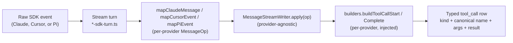

# Agent message mapping

Baguette runs sessions against three SDKs — **Claude** (`@anthropic-ai/claude-agent-sdk`),
**Cursor** (`@cursor/sdk`), and **Pi** (`@earendil-works/pi-coding-agent`). Each emits a
different raw event stream with its own
vocabulary, envelope shapes, and tool names. Everything in the chat, the dock, the
diff viewer, the running-tool badges, and the agent-status footer reads from a
single canonical typed vocabulary (`ToolCallKind`, `ToolCallPayload`, `MessageOp`).
The mapping from raw SDK events to that vocabulary is the focus of this page.

## High-level flow



A turn goes **SDK → stream turn → mapper → writer → builders → typed row**. Each box
replaces one piece of provider-specific work. The shared layer (writer, plan
markdown, user-payload normalizer) never imports from `server/`.

## Where each piece lives

### Stream turns — `server/services/{claude,cursor}/`

Owns the SDK-specific event source.

- **`claude/claude-sdk-turn.ts`** — `processClaudeQueryStream`. Iterates over the
  Claude SDK query stream and yields raw events for the agent service to consume.
  Extracted from `claude-agent.service.ts._consumeQuery` so the SDK loop is in one
  place, alongside its Cursor counterpart.
- **`cursor/cursor-sdk-turn.ts`** — `processCursorRunStream`. Same shape, for the
  Cursor SDK.
- **`pi/pi-sdk-turn.ts`** — `processPiSessionStream`. Same shape, for the Pi coding agent.

These files import the SDK types directly (`@anthropic-ai/claude-agent-sdk`,
`@cursor/sdk`, `@earendil-works/pi-coding-agent`). Nothing else under `server/services/` does.

### Event → `MessageOp` mapping — `server/services/{claude,cursor}/*.mapping.ts`

Translates one raw SDK event into one or more provider-neutral operations.

- **`claude-mapping.ts` → `mapClaudeMessage(sdkMsg): MessageOp[]`**
- **`cursor-mapping.ts` → `mapCursorEvent(sdkMsg): MessageOp[]`**
- **`pi-mapping.ts` → `mapPiEvent(sdkMsg): MessageOp[]`**

`MessageOp` is the discriminated union in `shared/message-types.ts`. Variants
include `assistant_text`, `tool_start`, `tool_result`, `thinking_tokens`,
`plan_created`, `task_notification`, `request_input`, and the system rows. Both
mappers return this same union — downstream code only sees the union.

Each mapper also owns a closed-vocabulary table for tool kinds and the
canonical-name mapping for its provider:

| Provider | Raw SDK tool name                                                | Canonical stored name   | `kind`                                                  |
| -------- | ---------------------------------------------------------------- | ----------------------- | ------------------------------------------------------- |
| Claude   | `Bash`                                                           | `Bash`                  | `bash`                                                  |
| Claude   | `Read` / `Write` / `Edit`                                        | same                    | `read` / `write` / `edit`                               |
| Claude   | `Glob` / `Grep`                                                  | same                    | `glob` / `grep`                                         |
| Claude   | `Task` / `Agent`                                                 | same                    | `task`                                                  |
| Claude   | `TaskCreate` / `TaskUpdate` / `TaskList`                         | `TodoWrite`             | `todo`                                                  |
| Claude   | `ExitPlanMode`                                                   | `ExitPlanMode`          | `exit_plan` (rendered as a `plan` row, not a tool_call) |
| Claude   | `WebFetch` / `WebSearch`                                         | same                    | `web_fetch` / `web_search`                              |
| Cursor   | `shell`                                                          | `Bash`                  | `bash`                                                  |
| Cursor   | `read`                                                           | `Read`                  | `read`                                                  |
| Cursor   | `write`                                                          | `Write`                 | `write`                                                 |
| Cursor   | `edit`                                                           | `Edit`                  | `edit`                                                  |
| Cursor   | `ls`                                                             | `Glob`                  | `glob`                                                  |
| Cursor   | `semSearch`                                                      | `Grep`                  | `grep`                                                  |
| Cursor   | `task`                                                           | `Task`                  | `task`                                                  |
| Cursor   | `updateTodos`                                                    | `TodoWrite`             | `todo`                                                  |
| Cursor   | `createPlan`                                                     | `ExitPlanMode`          | `exit_plan`                                             |
| Both     | `mcp__baguette__<tool>` / legacy `mcp` with `{ toolName, args }` | `mcp__baguette__<tool>` | `mcp`                                                   |

The canonical-name step happens **before** the kind lookup, so downstream
functions dispatch on the canonical vocabulary only.

### Op dispatch — `shared/message-stream-writer.ts`

`MessageStreamWriter` is provider-agnostic. It accepts `builders: ToolCallBuilders`
in `WriterDeps`:

```ts
type ToolCallBuilders = {
  buildToolCallStart: (callId, name, args, startedAt?) => ToolCallPayload;
  buildToolCallComplete: (prev: ToolCallPayload, opts) => ToolCallPayload;
};
```

For `tool_start` ops it calls `builders.buildToolCallStart(...)`. For
`tool_result` ops it calls `builders.buildToolCallComplete(...)`. It also
handles:

- One-shot `plan` rows (debounced; the latest plan markdown wins)
- One-shot `thinking_tokens` rows (debounced; the latest cumulative estimate is patched)
- Assistant text streaming (debounced text patches while streaming)
- Cancelling any in-flight tools on `finish()` (status `cancelled`)

The writer never imports from `server/` or `shared/message-mappers.ts` — those
files do not exist anymore.

### Op → `ToolCallPayload` builders — `server/services/{claude,cursor}/*.mapping.ts`

Each provider owns its `buildToolCallStart` / `buildToolCallComplete` pair. Both
are pure functions: `buildToolCallStart` takes a call id plus the raw
name and args, while `buildToolCallComplete` takes the previous payload and the
raw result. Both return a `ToolCallPayload` with the canonical `kind`,
normalized `args`, and terminal `result` / `status`.

- **Claude:** `claudeBuildToolCallStart`, `claudeBuildToolCallComplete`,
  `mapClaudeToolArgs`, `mapClaudeToolResult`, `mapClaudeBashToolResult`,
  `claudeCanonicalToolName`, `claudeToolKindFromName`. `mapClaudeToolResult`
  delegates MCP / generic content reduction to `formatClaudeToolResult` in
  `claude-tool-result.js`.
- **Cursor:** `cursorBuildToolCallStart`, `cursorBuildToolCallComplete`,
  `mapCursorToolArgs`, `mapCursorToolResult`, `mapCursorBashToolResult`,
  `cursorCanonicalToolName`, `cursorToolKindFromName`. The bash reducer unwraps
  Cursor's `{ status: 'success', value: { … } }` envelope via `unwrapCursorResult`.

### Builder injection — `server/services/message-writer-factory.ts`

`createMessageStreamWriter({ agentType: 'claude' | 'cursor', … })` picks the
right builder pair (`claudeBuilders` or `cursorBuilders`) and threads it into the
writer. The three callers pass the agent type explicitly:

- `claude-agent.service.ts` chat path — `'claude'`
- `cursor-agent.service.ts` chat path — `'cursor'`
- `cursor-agent.service.ts` review path — `'cursor'`

### DB persistence

`MessageStreamWriter` creates and patches rows in the `messages` table. The
stored row shape is canonical:

```json
{
  "type": "tool_call",
  "name": "Bash",
  "kind": "bash",
  "args": { "command": "git status" },
  "result": { "status": "ok", "error_message": null, "exit_code": 0, "stdout": "…", "stderr": "" },
  "tool_status": "completed",
  "tool_started_at": "…",
  "call_id": "…"
}
```

Plan rows are stored as `{ type: 'plan', markdown: '…' }`, not as tool_calls.

## Canonical vocabulary — `shared/message-types.ts`

`ToolCallKind` is a closed union: `'bash' | 'read' | 'write' | 'edit' | 'glob'
| 'grep' | 'task' | 'todo' | 'exit_plan' | 'web_fetch' | 'web_search' | 'mcp'
| …`. New kinds go in one place. The chat side (`ToolCallBlock.tsx`,
`EditDiffView.tsx`, `BaguetteMcpToolBlock.tsx`, `running-tools.js`) dispatches
on `kind`; it never branches on raw SDK names.

`ToolCallPayload` carries `{ kind, name, args, result, status, call_id,
tool_started_at, … }`. Both providers produce this same shape.

## Worked example — Cursor `shell` tool running `git status`

| Step | Code path                                                                                                                                                                                        | Output                                                                    |
| ---- | ------------------------------------------------------------------------------------------------------------------------------------------------------------------------------------------------ | ------------------------------------------------------------------------- |
| 1    | `cursor-sdk-turn.ts` receives `{ type: 'tool_call', name: 'shell', args: { command: 'git status' }, status: 'running', call_id: 'c1' }`                                                          | raw SDK event                                                             |
| 2    | `mapCursorEvent` produces `{ type: 'tool_start', call_id: 'c1', name: 'shell', args: { command: 'git status' } }`                                                                                | `MessageOp`                                                               |
| 3    | `writer.apply(op)` calls `builders.buildToolCallStart('c1', 'shell', { command: 'git status' })`                                                                                                 | dispatches to Cursor builder                                              |
| 4    | `cursorBuildToolCallStart` runs `cursorCanonicalToolName('shell')` → `'Bash'`, `cursorToolKindFromName('Bash')` → `'bash'`, `mapCursorToolArgs('bash', 'Bash', …)` → `{ command: 'git status' }` | `ToolCallPayload { kind: 'bash', name: 'Bash', args, status: 'running' }` |
| 5    | Writer creates `{ type: 'tool_call', name: 'Bash', kind: 'bash', args, tool_status: 'running' }` row                                                                                             | typed row in DB                                                           |

On Claude, the same flow starts with `{ type: 'assistant', content: [{ type:
'tool_use', id: 'tu_1', name: 'Bash', input: { command: 'git status' } }] }`,
which `mapClaudeMessage` flattens into the same `MessageOp`. Both produce the
**same canonical row**.

## Worked example — Claude TaskCreate → TodoWrite row

Claude's `TaskCreate`, `TaskUpdate`, and `TaskList` tools all collapse into the
`TodoWrite` tool (which is what the chat renders as todos). The flow:

| Step | Code path                                                                                                                                 | Output                                                   |
| ---- | ----------------------------------------------------------------------------------------------------------------------------------------- | -------------------------------------------------------- |
| 1    | Claude SDK emits `tool_use` with `name: 'TaskCreate'`                                                                                     | raw SDK event                                            |
| 2    | `mapClaudeMessage` returns `{ type: 'tool_start', name: 'TaskCreate', … }`                                                                | `MessageOp`                                              |
| 3    | `claudeBuildToolCallStart` runs `claudeCanonicalToolName('TaskCreate')` → `'TodoWrite'`, `claudeToolKindFromName('TodoWrite')` → `'todo'` | `ToolCallPayload { kind: 'todo', name: 'TodoWrite', … }` |
| 4    | Writer creates `{ type: 'tool_call', name: 'TodoWrite', kind: 'todo', args: { todos: […] } }`                                             | typed todo row                                           |

Cursor's `updateTodos` lands on the same row shape through
`cursorCanonicalToolName('updateTodos')` → `'TodoWrite'`.

## What lives where, at a glance

| Concern                     | Location                                                         |
| --------------------------- | ---------------------------------------------------------------- |
| Claude SDK types            | `server/services/claude/claude-mapping.ts`, `claude-sdk-turn.ts` |
| Cursor SDK types            | `server/services/cursor/cursor-mapping.ts`, `cursor-sdk-turn.ts` |
| Stream turns                | `server/services/{claude,cursor}/*-sdk-turn.ts`                  |
| Event → `MessageOp` mappers | `server/services/{claude,cursor}/*-mapping.ts`                   |
| `ToolCallPayload` builders  | same files (one provider-owned pair per file)                    |
| Provider-agnostic writer    | `shared/message-stream-writer.ts`                                |
| Builder injection           | `server/services/message-writer-factory.ts`                      |
| Canonical typed vocabulary  | `shared/message-types.ts`                                        |
| Plan markdown extraction    | `shared/plan-markdown.ts`                                        |
| User payload normalization  | `shared/normalize-user-payload.js`                               |
| Chat rendering              | `client/src/components/chat/*.tsx` (dispatches on `kind`)        |
| Running-tool dock / badges  | `shared/running-tools.js`, `client/src/components/chat/*Dock*`   |

## Adding a new tool kind

1. Add the kind to `ToolCallKind` in `shared/message-types.ts`.
2. Add the canonical-name entry to `claudeToolKindFromName` / `cursorToolKindFromName`
   in the relevant per-provider mapping file (only if the kind applies to that
   provider).
3. Add the args / result mapping to `mapClaudeToolArgs` / `mapCursorToolArgs`
   and `mapClaudeToolResult` / `mapCursorToolResult`.
4. Add the `buildToolCallStart` / `buildToolCallComplete` handling — usually a
   pass-through, but copy `Bash` if the tool has its own envelope.
5. Update chat rendering if the kind needs a new component (most kinds reuse
   `ToolCallBlock.tsx`); otherwise add a branch to the `kind` switch in
   `ToolCallBlock.tsx`.

## Adding a new provider

1. Create `server/services/<provider>/<provider>-sdk-turn.ts` and
   `<provider>-mapping.ts`.
2. Implement `map<Provider>Message(sdkMsg): MessageOp[]` covering the SDK's event
   surface. Re-use the existing `MessageOp` variants where they fit; add new
   variants to `shared/message-types.ts` only if you need them.
3. Implement `<provider>BuildToolCallStart` / `<provider>BuildToolCallComplete`
   and the `canonical<Provider>ToolName` / `toolKindFromName` helpers.
4. Extend `MessageWriterOpts.agentType` and `createMessageStreamWriter` to
   thread the new builder pair.
5. Add the agent type to the session row (`server/services/feathers/*` and
   `server/migrations/*`) and to the client (`Session.agent_sdk`).
6. Write per-provider tests under
   `server/services/<provider>/__tests__/<provider>-mapping.test.js`.

## Why per-provider mapping is split

Per the refinement that **each SDK should own its own message mapper**, there is
no longer a `shared/message-mappers.ts`. A shared mapper inevitably grows
provider-specific knowledge (`CURSOR_TOOL_ALIAS`, `CLAUDE_TASK_TOOLS`, a direct
import of `claude-tool-result.js`). Splitting the mappers means:

- New SDK additions don't pollute shared code.
- Each provider's closed vocabulary lives in one file, where it can be read and
  audited.
- The shared layer (`shared/`) stays small, typed, and free of SDK imports.
- The writer (`shared/message-stream-writer.ts`) can be reasoned about without
  knowing which provider it serves.
